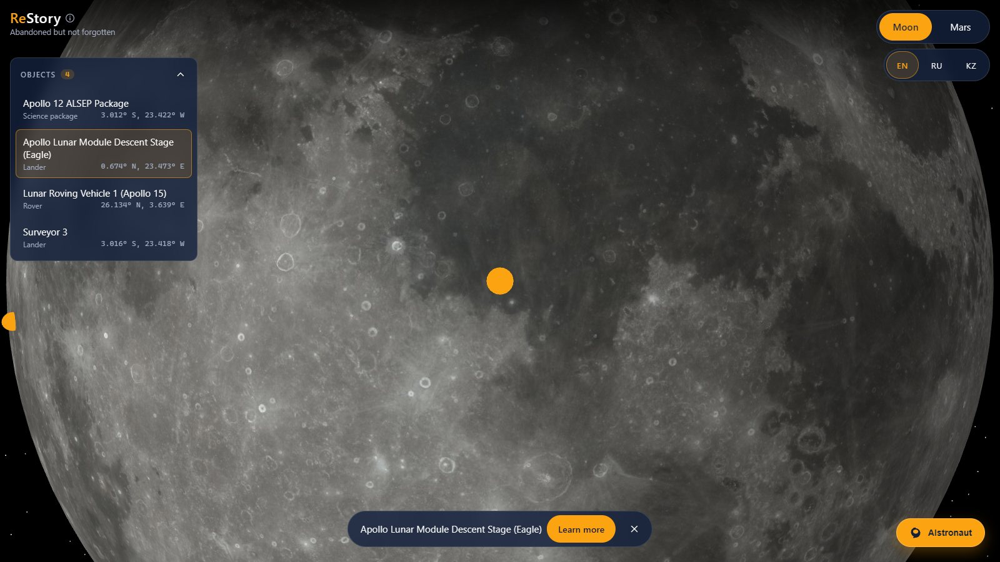
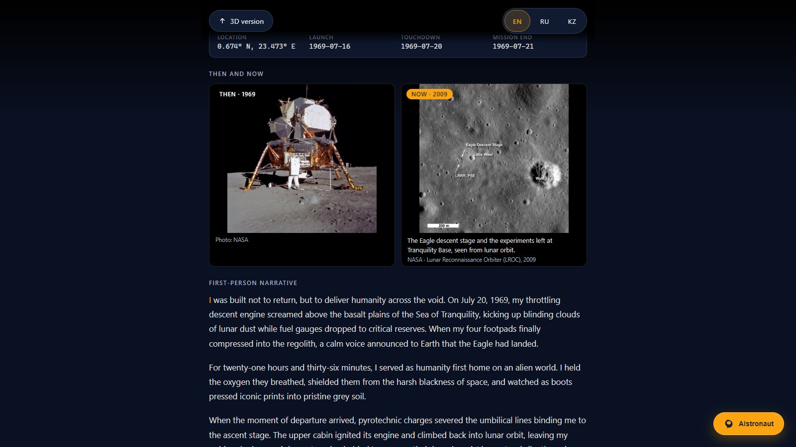
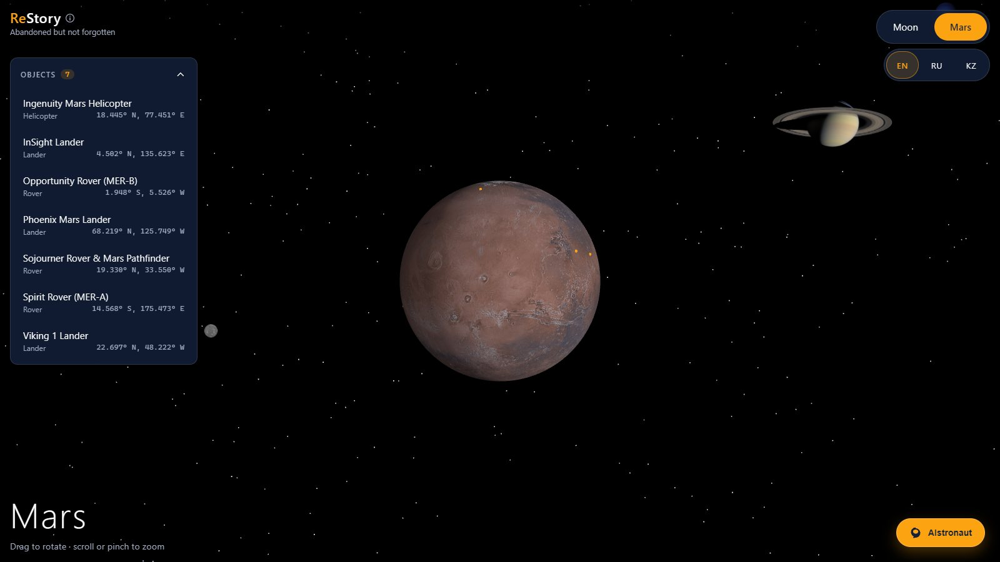
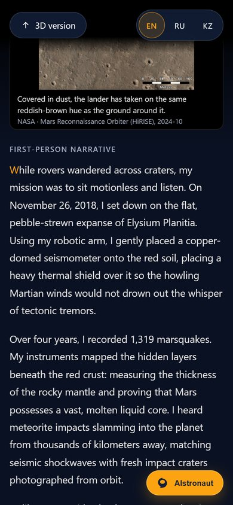

# ReStory

**Abandoned but not forgotten.** An interactive 3D museum of the NASA equipment that stayed forever on the Moon and Mars, where every machine tells its own story.

NASA Space Apps Challenge 2026 · Challenge: *Abandoned but not Forgotten: Storytelling about NASA's Discarded Equipment on the Moon and Mars*



## What it is

Dozens of NASA landers, rovers and science stations are still sitting where their missions ended. ReStory brings them back into the story. Visitors fly to the real landing sites, open each machine's museum page and hear it speak in the first person: why it was built, what it went through and why it fell silent. A "Then and now" view shows the same site today, photographed from orbit, so the heritage is not just remembered but still visible.

## Why ReStory

Every machine here finished its mission and stayed exactly where it stopped: in the lunar dust or under Martian dust storms. Nobody will come back for them, but their stories can be told again. The name joins three ideas: re-story, telling the story anew, in the machine's own voice; restore, bringing it back from oblivion; and history, the decades of exploration these machines carry. Hence our motto: abandoned, but not forgotten.

## Features

- **3D Moon and Mars** with NASA surface maps (up to 8k), the Earth, the Sun and the other planets in the background.
- **NASA 3D models on the surface:** fly to Apollo 11, Viking 1, Spirit, Opportunity, InSight or Ingenuity and the marker turns into the official NASA 3D model that you can orbit and zoom. Models are loaded one at a time, only when needed. Apollo 11 shows only the descent stage, as on the Moon today.
- **Real landing and impact sites:** 28 objects in the catalog; 20 of them stand at their catalogued coordinates: 11 on the Moon (Apollo 11 Eagle, Apollo 12 ALSEP, Apollo 15 Lunar Roving Vehicle, Surveyor 3, Lunar Orbiter 1, LCROSS, SMART-1, Kaguya, SLIM, Luna 9, Lunokhod 1) and 9 on Mars (Sojourner and Pathfinder, Spirit, Opportunity, Viking 1, Phoenix, InSight, Ingenuity, Beagle 2, Mars 3). Orbiters and deep-space probes (Mariner 9, Mars Global Surveyor, Dawn, NEAR Shoemaker, Pioneer 10 and 11, Kepler, Philae, MASCOT) are in the catalog and the museum.
- **Museum pages:** a first-person story, key facts, mission dates and location, sister missions, a NASA photo and links to the NASA sources for every object.
- **Then and now:** a mission-era photo next to a present-day image of the site from the Lunar Reconnaissance Orbiter, HiRISE on Mars Reconnaissance Orbiter, or the Perseverance rover.
- **Catalog without 3D:** browsers without WebGL open a catalog of every object grouped by place, with photos and short descriptions; each item opens its museum page. The same page opens with `?view=catalog`.
- **Object cards and automatic tour:** clicking an orange marker or a list item flies to the object and opens a card with its photo, type, coordinates and a short description; the tour visits every object on its own.
- **AIstronaut guide:** a chat guide that answers questions about the missions using only the museum's NASA-sourced texts.
- **Three languages:** English, Russian and Kazakh, switchable at any moment.
- **Works everywhere:** desktop, phone and kiosk screens; image quality adapts to the device; respects reduced-motion settings.

| Then and now | Mars | On a phone |
|---|---|---|
|  |  |  |

## NASA data

NASA data is the core of the project:

- **Surface maps:** Moon from the [NASA Scientific Visualization Studio CGI Moon Kit](https://svs.gsfc.nasa.gov/4720) (Lunar Reconnaissance Orbiter), Mars from [NASA Solar System Treks](https://trek.nasa.gov/mars/) (Viking color mosaic), Earth from NASA GIBS (Blue Marble).
- **Equipment facts, dates and coordinates:** [NASA Space Science Data Coordinated Archive (NSSDCA)](https://nssdc.gsfc.nasa.gov/), NASA Science mission pages and NASA Photojournal; for the machines of other agencies (USSR, ESA, JAXA) also ESA and JAXA mission pages.
- **3D models:** [NASA 3D Resources](https://science.nasa.gov/3d-resources/), 11 models: Apollo Lunar Module and Viking Lander (NASA/Michael D. Carbajal); Mars Exploration Rover (NASA/Ames Research Center); InSight, Ingenuity and Dawn (NASA/Brian E. Kumanchik); Kepler (NASA/Brian E. Kumanchik, NASA/Christian A. Lopez); Mars Global Surveyor and Pioneer 10 (NASA/JPL/Eyes on the Solar System); NEAR Shoemaker and Rosetta (NASA). Landers and rovers appear on the globe; every model can also be turned on the object's museum page.
- **Photographs and "Then and now" views:** [NASA Image and Video Library](https://images.nasa.gov/) (Apollo, Lunar Orbiter, LCROSS, LRO, Viking, Mariner 9, Mars Global Surveyor, Mars Exploration Rovers, Phoenix, InSight, Mars 2020, HiRISE and more). Each photo shows its author from the NASA record (for example NASA/JPL-Caltech/Univ. of Arizona); the one non-NASA photo, Philae on the comet, is credited ESA/Rosetta/Philae/CNES/FD.

Every map, fact, photo and 3D model, object by object, with its source and author: [docs/SOURCES.md](docs/SOURCES.md).

## Run locally

You need Python 3.12+, PostgreSQL and, for the chat guide, [Ollama](https://ollama.com/).

1. Create an empty PostgreSQL database `bd_re_story`:
   ```bash
   psql -U postgres -c "CREATE DATABASE bd_re_story;"
   ```
2. Pull the chat models:
   ```bash
   ollama pull gemma4:e2b
   ollama pull nomic-embed-text
   ```
3. Set up the project:
   ```bash
   git clone https://github.com/AzaKail/re-story.git
   cd re-story
   python -m venv .venv
   .venv\Scripts\activate            # macOS / Linux: source .venv/bin/activate
   pip install -r requirements.txt
   copy .env.example .env            # macOS / Linux: cp .env.example .env
   ```
   Put your PostgreSQL password into `DB_PASSWORD` in `.env`.
4. Create the database tables (this also loads the equipment catalog), load the chat knowledge base and start:
   ```bash
   python manage.py migrate
   python manage.py load_knowledge
   python manage.py runserver
   ```
5. Open http://127.0.0.1:8000/. Add `?lang=ru` or `?lang=kk` for Russian or Kazakh, `#mars` to start on Mars.

**On a phone in the same Wi-Fi network:** start the server with `python manage.py runserver 0.0.0.0:8000` and open `http://<computer IP>:8000/`. On Windows the Wi-Fi network must be set to "Private".

## Editing the content

- **Equipment catalog:** everything about the objects (coordinates, dates, stories, facts, translations, photos, "Then and now") lives in [data/artifacts.json](data/artifacts.json). After editing, run `python manage.py seed_catalog`, then `python data/build_knowledge_base.py` and `python manage.py load_knowledge` to update the chat guide.
- **Chat knowledge base:** texts in `data/knowledge/<language>/`. More documents can be uploaded in the admin panel (`python manage.py createsuperuser`, then http://127.0.0.1:8000/admin/).
- **Chat models:** set `OLLAMA_CHAT_MODEL` and `OLLAMA_EMBED_MODEL` in `.env`. After changing the embedding model, re-index with `python manage.py load_knowledge --reindex`.
- **Interface texts:** [static/js/i18n.js](static/js/i18n.js), with the same keys in English, Russian and Kazakh.

## Tech stack

| Layer | Technology |
|---|---|
| Server | Python, Django 5.2, PostgreSQL |
| 3D | Three.js r170 with GLTFLoader and Draco decoder (bundled, works offline) |
| Interface | Django templates, plain CSS and JavaScript modules, no build step |
| Chat guide | Ollama: Gemma (answers) and nomic-embed-text (search), retrieval over the museum texts |

```text
config/        Django settings and URL routing
catalog/       equipment catalog: models, API, data loading
ai_assistant/  AIstronaut chat guide
templates/     HTML templates
static/        JavaScript, CSS, NASA textures, Three.js
data/          catalog data and chat knowledge base texts
docs/          documentation, sources, screenshots
```

Technical change log: [docs/documentation.md](docs/documentation.md).

## Team

- **Azamat Maksutov, Team lead, 3D scene and interface.** Built the 3D world in Three.js: the Moon and Mars on NASA maps, smooth camera flights to every object, NASA 3D models that appear on the surface, the museum pages with then and now views, this window and the catalog page for browsers without 3D. Made the site work in three languages and on phones, and brought the whole team's work together.
- **Dmitry Minin, AIstronaut guide.** Built the AIstronaut chat guide: a local language model (Ollama) that first finds the right passages in the museum knowledge base (vector search in PostgreSQL) and answers only from them. Set up the database and the admin pages for loading knowledge documents.
- **Aijan Amaliya, Catalog and museum texts.** Designed the catalog and the museum card, then expanded it from 15 to 28 objects, adding Soviet, European and Japanese machines left on the Moon, on Mars, on a comet and on an asteroid. Gathered facts from NSSDCA and mission pages and wrote every story in English, Russian and Kazakh. Turned the texts into the knowledge base the guide answers from, wrote the catalog tests and the planet overview shown when nothing is selected.
- **Zaur Kavirov, Automatic tour and catalog design.** Made the automatic tour: one button sends the camera from object to object on its own, every 15 seconds or every 5 at double speed, while a plaque gives a short summary of each one. Designed the first version of that plaque, redesigned the AIstronaut input field and gave the catalog its new look.

## Use of SI tools

ReStory was designed and mostly built by the team. AI assistants provided a starting base and helped in places with code, documentation and translations; the team extended, reviewed and tested everything. All images in the project come from NASA; none are generated. The AIstronaut guide is an AI feature of the product: it runs a local open model and answers only from the museum texts.

## Credits

Images and data courtesy of NASA. ReStory is a Space Apps Challenge project and is not endorsed by NASA.
